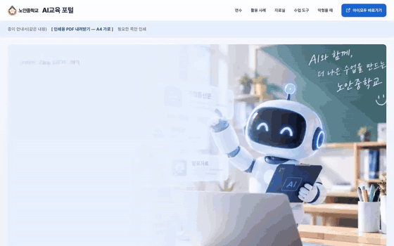
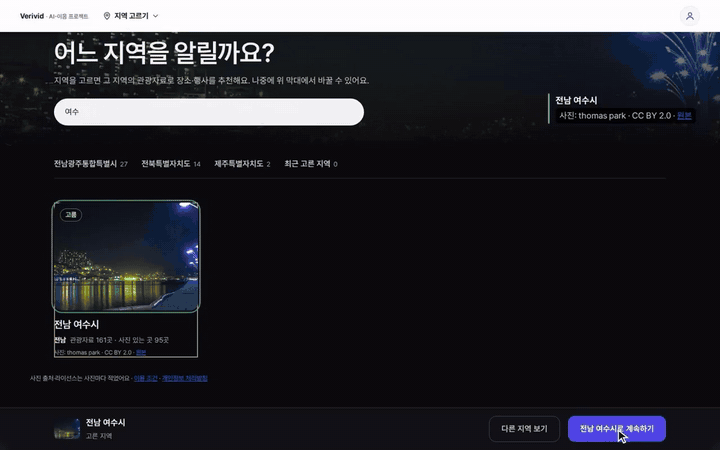

# 박진영 · Jinyoung Park

### 검증 먼저, 운영까지.

AI로 **실제 사람들이 쓰는 서비스**를 만들고, 직접 배포해서 운영합니다. 
결과 숫자가 좋게 나오면 **그 숫자가 진짜인지 먼저 확인**하고, 확인되지 않은 건 쓰지 않습니다.

AI · 백엔드 개발자 (신입) · 광주 · 동신대학교 컴퓨터공학과

 

## 👀 한눈에 보기

| 프로젝트 | 한 줄 설명 | 상태 |
|:--|:--|:--|
| **[노안중 AI 운영 사이트](https://github.com/zln02/noan-ai)** | 선생님 12명이 AI를 업무에 쓰도록 돕는 학교 사이트 | 🟢 운영 중 · 혼자 개발 |
| **[교사 스튜디오](https://github.com/zln02/teacher-studio)** | 선생님이 말 한 줄로 수업 게임·슬라이드를 만드는 AI 도구 | 🟢 무료 공개 |
| **AI-이음** | 관광지를 고르면 사실 확인된 홍보 쇼츠를 만들어 주는 AI | 🟡 현장 실증 · 코드 비공개 |
| **[곁눈](https://github.com/zln02/gyeotnun)** | 어르신이 받은 의심 문자를 함께 확인해 주는 AI | 🏅 해커톤 아이디어상 |
| **[Urban Immune](https://github.com/zln02/urban-immune-system)** | 생활 데이터로 감염병 유행을 미리 알리려 한 실험 | 🏆 공모전 대상 |
| **[ThinQ Sentinel](https://github.com/zln02/thinq-workspace-sentinel)** | 요양병원 감염 위험에 맞춰 LG 가전을 켜는 IoT 시제품 | 🏅 DX School 장려상 |
| **[Quant Agent](https://github.com/zln02/quant-agent)** | 코인·주식 자동매매 시스템, 4개월 운영 후 종료 | 📦 보관 |

 

## 🎬 움직이는 걸로 보기

<table>
<tr>
<td width="50%" valign="top">

 <b>노안중 AI 운영 사이트</b> 
"무엇을 하시려고요?"로 시작해 업무를 고르면 따라 할 순서와 AI에게 보낼 문장을 보여 줍니다.
</td>
<td width="50%" valign="top">

 <b>교사 스튜디오</b> 
「5학년 과학 태양계 퀴즈쇼 만들어 줘」 한 줄로 만든 결과입니다.
</td>
</tr>
<tr>
<td width="50%" valign="top">

 <b>AI-이음</b> 
장소 고르기 → 대본 → 만들기 → 받기. 만들기 전에 사실·저작권·AI 표시를 확인합니다.
</td>
<td width="50%" valign="top">
<b>곁눈</b> — <a href="https://zln02.github.io/gyeotnun/watch.html">43초 시연 영상 ▶</a> 
AI가 "안전합니다"라고 판정하는 대신, 공식 근거와 "이건 확인해 보셨나요?" 질문을 보여 줍니다.
  
<b>더 자세한 내용</b> — <a href="https://zln02.github.io">포트폴리오 페이지 ▶</a> 
프로젝트마다 문제 → 만든 것 → 결과, 그리고 검증 과정을 정리했습니다.
</td>
</tr>
</table>

 

## 🔍 숫자를 이렇게 다룹니다

| 처음 나온 숫자 | 다시 확인한 방법 | 그래서 |
|:--|:--|:--|
| 곁눈 정답률 **95.5%** | 시험 문제가 쉬웠다고 보고 22개 → 120개로 늘려 다시 측정 | **70%**를 실제 수준으로 채택 |
| Urban Immune 경보 점수 **0.907** | 정답이 입력 데이터로 만든 값이라 실제 환자 통계와 비교 | 거의 일치하지 않음 → **한계로 공개** |
| 운영 회고 초안의 "8시간 장애" | 로그·커밋에서 근거를 찾아봄 | 확인할 수 없어 **삭제** |

 

## 🛠 주로 쓰는 것

**서버·배포** — 서버를 만들고, 컨테이너로 포장해 클라우드에 올리고, 문제가 생기면 알림이 오게 합니다. 
      

**AI** — AI가 답하기 전에 공식 문서를 먼저 찾게 하는 구조(RAG)와, AI가 정해진 도구·점검 규칙 안에서 일하게 하는 틀을 만듭니다. 
     

**데이터** — 데이터를 모아 모델을 만들고, 미래 정보가 섞이지 않게 시간 순서대로 검증합니다. 
   

 

## 🏅 이력

**LG전자 DX School 5기 수료** (992시간) · **노안중학교 AI교육 코디네이터** (2026.09 –) · 정보처리기사 필기 합격

| 시기 | 수상 |
|:--|:--|
| 2026.09 | K-디지털 트레이닝 해커톤 아이디어상 · 곁눈 |
| 2026.06 | LG전자 DX School DX 프로젝트 장려상 · ThinQ Sentinel |
| 2026.03 | LG전자 DX School CX 프로젝트 최우수상 |
| 2026.03 | 한국능률협회 데이터로 미래를 그리는 AI 아이디어 공모전 **대상** · Urban Immune |
| 2025.11 | 동신대 EM 공학콘서트 창의적 종합설계 **대상** · 스마트 벌통 |
| 2025.06 | 동신대 기업분석 경진대회 입상 |
